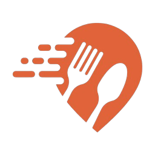
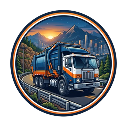
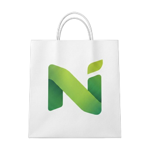
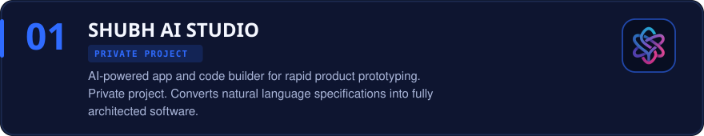
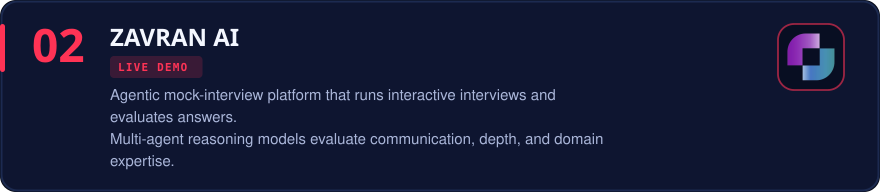
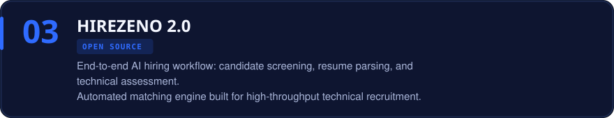

 

 

 &nbsp;
 &nbsp;
 &nbsp;
 &nbsp;
 &nbsp;
 &nbsp;
 &nbsp;
 &nbsp;
 &nbsp;
 &nbsp;
 &nbsp;
 &nbsp;
 &nbsp;

 

 

 

 

 

 

 

 

 

 

<a href="mailto:dileepgalla200056@gmail.com" title="Send Email"> &nbsp; <b>dileepgalla200056@gmail.com</b></a> &nbsp;&nbsp;&nbsp;&nbsp;&nbsp;&nbsp;
<a href="https://www.linkedin.com/in/galla-dileep-sai-b85829390/" target="_blank" rel="noopener noreferrer" title="Connect on LinkedIn"> &nbsp; <b>LinkedIn</b></a> &nbsp;&nbsp;&nbsp;&nbsp;&nbsp;&nbsp;
<a href="https://github.com/shdileep" target="_blank" rel="noopener noreferrer" title="View GitHub Profile"> &nbsp; <b>GitHub</b></a> &nbsp;&nbsp;&nbsp;&nbsp;&nbsp;&nbsp;
<a href="https://galladileep.netlify.app/" target="_blank" rel="noopener noreferrer" title="Visit Portfolio"> &nbsp; <b>Portfolio</b></a>

 

