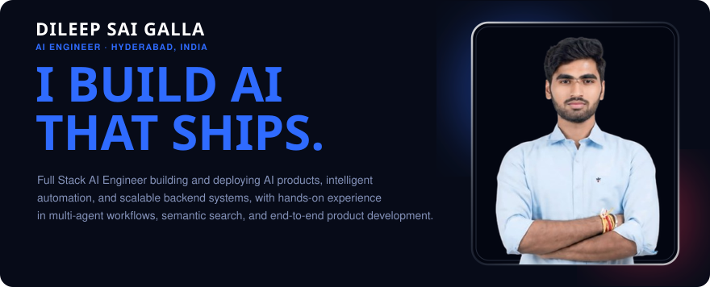
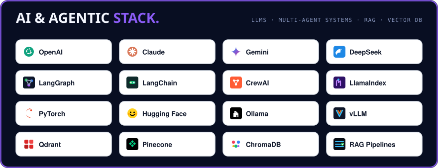
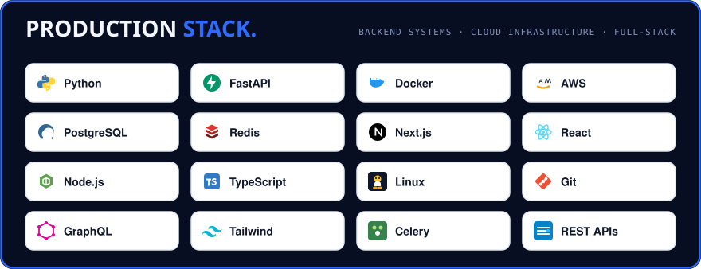

  
 &nbsp;
 &nbsp;
 &nbsp;
 &nbsp;
 &nbsp;
 &nbsp;
 &nbsp;
 &nbsp;
 &nbsp;
 &nbsp;
 &nbsp;
 &nbsp;
 &nbsp;

 

  

  

  

  

  

  

[Portfolio](https://galladileep.netlify.app/) &nbsp;|&nbsp; [GitHub](https://github.com/shdileep) &nbsp;|&nbsp; [Zavran AI](https://zavran-ai.vercel.app/index.html) &nbsp;|&nbsp; [Shubh AI Studio (Private Portfolio)](https://galladileep.netlify.app/)

 

